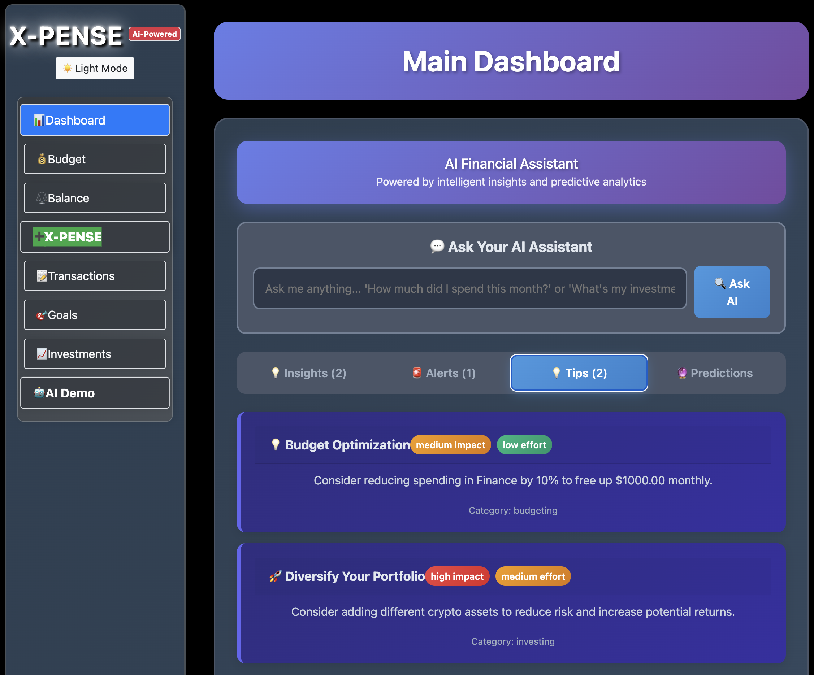

<div style="text-align: center;">
    <h1>X-PENSE</h1>
</div>

<!-- # X-pense App -->


A full-stack personal finance tracker built with React and Flask. Transaction categories are suggested by OpenAI and the dashboard's question box is answered by OpenAI; everything else described here is plain, deterministic code.

**Live site:** [https://x-penseapp.com](https://x-penseapp.com)

Create an account to get your own private profile. Your transactions, budgets, balances, goals and investments are only visible to you.

## About

X-PENSE lets you track your cash on hand, bank account balances, savings and expenses, and set financial goals. The backend is Flask and the frontend is React. Under the Investments tab you can follow live crypto prices and add them to the dashboard to calculate your overall budget.

## 🤖 What is (and is not) AI

Two features call an AI model (category suggestions and the dashboard question box). The rest are rules and arithmetic that run in your browser. They are useful, but they are not artificial intelligence, and this README says so on purpose.

### Real AI: category suggestions (OpenAI)

When you type a transaction description, X-PENSE suggests a category.

- **How it works**: after you pause typing, the browser asks the server (`POST /ai/categorize`). The server asks an OpenAI model (default `gpt-6-luna`, set with `OPENAI_MODEL`) and returns one category name.
- **It can invent categories**: the model is told to prefer your existing categories, but to create a new short name (for example "Wedding") when none really fits. The banner then reads "AI suggests a new category". The category is only added to your list if you click **Use This** and save the transaction.
- **It follows your habits**: each request includes your own category names and your 20 most recent transactions, so the suggestion reflects how *you* label things. The model itself is not trained on your data and does not remember anything between requests.
- **Safe by design**: the model must answer in a fixed JSON shape, and the server cleans and validates the category name (30 characters or fewer, letters, digits, spaces and a few symbols only) before it reaches the browser. If the name is not acceptable, it is ignored.
- **Always works without it**: if OpenAI is not configured, is slow, fails, or a limit is reached, the form falls back to a small built-in keyword matcher (for example "starbucks" gives Food & Dining) and labels it "Based on keywords". Adding a transaction never depends on OpenAI.

**What is sent to OpenAI for category suggestions**

| Sent | Never sent |
|---|---|
| The description (and amount, if you typed one) of the transaction being added | Your email or account id |
| Your category names (standard list plus your own) | Your balances, budgets, goals or investments |
| Description and category of your 20 most recent transactions | Your password or login token |

Requests are marked `store: false`, which asks OpenAI not to keep them; see OpenAI's own data policy for details. The API key lives only on the server and is never sent to the browser.

**Cost controls**: each account is limited to 60 suggestions per hour, and the whole app to 1000 per day. Every request has a 10 second timeout. Set a monthly spending limit in your OpenAI account as a second safety net.

### Real AI: the dashboard question box (OpenAI)

On the Dashboard, the "Ask Your AI Assistant" box answers free-form questions about your money, such as "How much did I spend last month?" or "Am I spending more than usual?".

- **How it works**: the browser sends only your question to the server (`POST /ai/ask`). The server adds up your numbers itself from its own database and sends them with the question to an OpenAI model. Because the totals are calculated in plain code, the model only has to explain them, not do the arithmetic. The browser never sends numbers, so they cannot be altered from the outside.
- **It says when it cannot tell**: the model is told to use only the totals it is given, to say so plainly when they cannot answer a question (for example "what was my biggest purchase?", since it never sees individual purchases), and not to guess. It also knows the current month is unfinished, so it does not call a partial month "low".
- **Always works without it**: if OpenAI is unavailable, slow, or your limit is reached, the box answers with a simple keyword matcher instead and labels the answer "Keyword answer" with the reason.

**What is sent to OpenAI for questions**

| Sent | Never sent |
|---|---|
| Your question | Transaction descriptions |
| Spending totals per month and per category for the last 6 months (top 10 categories per month, the rest grouped), the average of finished months, and for the current month how much is dated up to today versus dated later | Your email, password, login token or account id |
| Today's date | Names of your budget items |
| Your balance (cash, bank, savings), total budget amount and number of budget items | |
| Name, target and amount saved of each goal (up to 20), name and value of each investment (up to 20) | |

Requests are marked `store: false`. **Cost controls**: each account may ask 20 questions per hour, and the whole app 300 per day, tracked separately from category suggestions. Each question has a 25 second timeout and the question is limited to 300 characters.

### Not AI: rule-based smart features

These run entirely in the browser, use fixed rules or simple formulas, and make no network calls to any AI service.

- **Dashboard insights and alerts** (`dashboardAI.js`, shown in the AI Insights panel): rules over your own data, such as "X% of your spending is in one category" or "you spent more than usual".
- **Predictions**: simple arithmetic. Next month's spending is your average weekly spending times 4.33, and the budget runway and goal completion dates are straight-line estimates. They are rough guides, not forecasts.
- **Financial health score, emergency fund coverage and liquidity ratio** (`financialCalculator.js`): standard formulas.
- **Smart update validation** (`smartUpdateService.js`): fixed rules that comment on your balance updates, for example warning about a very high share of cash or a low share of savings. The code also contains rules for budgets and investments, but only the balance screen uses them today. The "market timing" hint is a placeholder, not real market analysis.
- **Keyword fallbacks**: the category matcher (`aiCategorization.js`) and the question-box keyword matcher (`dashboardAI.js`) are the backups used when OpenAI is not available. The keyword question matcher looks for words such as "spent", "month", "balance" or "goal" and replies with a prepared answer, so it cannot understand free-form language. The category matcher remembers your corrections in your browser's `localStorage`.

Note: the rule-based features keep their small bits of history and preferences in `localStorage`, which belongs to the browser, not to your account. Anyone sharing a browser profile shares that data.

## CORE-Features

- Add and manage transactions, with category suggestions
- Edit categories on any transaction; your own categories show up in the dropdown next time
- Set and track budget goals
- Bulk updates for balances (add, subtract, set or apply a percentage to several accounts at once)
- Investment portfolio with live crypto prices
- View balance and budget summaries
- Dark-Light mode support
- Mobile compatibility
- **User accounts**: sign up and log in with email and password; each user's data is private to their account, with an owner/admin role
- **Password reset by email**: a "Forgot password?" link sends a single-use reset link that expires after 30 minutes; resetting a password also logs out every other session
- **Security basics**: login and reset rate limiting, input validation on every data route, a CORS allow-list and a request size cap
- Responsive graphs and progress bars
- CRUD operations
- Input validation checks

### SERVER - Backend Activation
Before the first run, copy `Server/.env.example` to `Server/.env` and fill in:

- `DATABASE_URL`: your Postgres connection string (Supabase session pooler in production)
- `SECRET_KEY`: a long random string that signs login tokens. The server will not start without it. Generate one with `python3 -c "import secrets; print(secrets.token_hex(32))"`
- `ADMIN_EMAIL`: the account that signs up with this email becomes the owner/admin
- `RESEND_API_KEY` (optional locally): API key from [Resend](https://resend.com) used to email password reset links. Without it, the reset link is printed in the server terminal instead of being emailed
- `APP_URL` (production only): the address of the front-end, used to build the link in reset emails (for example `https://x-penseapp.com`). Locally it defaults to `http://localhost:5173`
- `OPENAI_API_KEY` (optional): API key from [OpenAI](https://platform.openai.com) used for category suggestions and dashboard answers. Without it the app simply uses the keyword fallbacks. Create the key inside its own OpenAI project with restricted permissions
- `OPENAI_MODEL` (optional): the model to use. Defaults to `gpt-6-luna`; change it here instead of in the code

Never commit `.env`.

<!-- pipenv install -->
<!-- pipenv shell -->
1. Navigate to the `Server` directory:
```
cd Server
```
2. Install the dependencies:
```
pip install -r requirements.txt
```
3. Run the Flask application:
```
python app.py
```

### CLIENT - Frontend Activation
1. Navigate to the `Client` directory:
```
cd Client
```
2. Use the right Node version and install the dependencies:
```
nvm use 20.16
npm install
```
3. Start the React application:
```
npm run dev
```

## Usage

- **Dashboard**: all your transactions in one place, with charts, rule-based insights and a question box answered by OpenAI
- **Add transactions**: type a description and get a category suggestion from OpenAI (or the keyword fallback)
- **Balance management**: track cash on hand, bank account balance and savings, with a financial health score
- **Goals**: set future goals and track progress with estimated completion dates
- **Investments**: monitor crypto investments with live price updates

## RESTful APIs:
`GET` | `PUT` | `POST` | `DELETE`

Main routes: `/transactions`, `/budgets`, `/balance`, `/goals`, `/investments`, plus `/ai/categorize`, `/categories` and `/ai/ask` for the AI features.

| Route | Method | What it does |
|---|---|---|
| `/ai/categorize` | `POST` | Body `{"description": "...", "amount": 12.5}` (amount optional). Returns `{"category": "...", "source": "openai", "isNew": false}`. Answers `503` when AI is unavailable and `429` when your hourly limit is reached |
| `/categories` | `GET` | The standard categories plus any you have used |
| `/ai/ask` | `POST` | Body `{"question": "..."}` (300 characters at most). Returns `{"answer": "...", "source": "openai"}`. Answers `503` when AI is unavailable and `429` when your hourly limit (20) is reached |

## Route Testing With POSTMAN
Every route except `/register`, `/login`, `/forgot-password` and `/reset-password` requires a login token. Send `POST /login` with `{"email": "...", "password": "..."}`, then add the returned token to each request as the header `Authorization: Bearer <token>`.

`GET` Route
```
http://localhost:5001/investments
```

`POST` Route
```
http://localhost:5001/investments
```
```
Example:

{
    "name": "Bitcoin",
    "pricePerUnit": 96063.00,
    "amount": 1,
    "totalPrice": 96063.00
}
```

`PUT` Route
```
Example:

{
    "amount": 1,
    "totalPrice": 96063.99
}
```

`DELETE` Route <sup>Replace the id# with your id</sup>
```
http://localhost:5001/investments/97
```

## 🔧 Technology Stack

### Frontend Technologies
- **React 18+**: JavaScript library with hooks
- **Bootstrap 5**: Responsive CSS framework with custom dark/light mode support
- **HTML5/CSS3**: Modern web standards
- **JavaScript ES6+**: async/await, destructuring and modules

### Backend Technologies
- **Flask 2.x**: Lightweight Python web framework with a RESTful API design
- **SQLAlchemy**: ORM for the database models and queries
- **PostgreSQL (Supabase)**: Production database, with a local SQLite fallback for development
- **PyJWT**: Signed login tokens for user accounts, with passwords stored as salted hashes, and signed single-use links for password reset
- **Resend**: Transactional email service that delivers password reset emails from `noreply@x-penseapp.com`
- **OpenAI API**: Category suggestions and dashboard answers through the Responses API with structured (JSON schema) output, called only from the server
- **Flask-Migrate**: Database version control and migration management
- **Flask-CORS**: Cross-origin resource sharing for frontend-backend communication

### Development & DevOps
- **Python 3.8+**
- **Node.js 20.16+**
- **npm/pipenv**: Package management for the frontend and backend
- **Git**: Version control
- **VS Code / Cursor**: Development environment
- **Cloudflare Pages**: Hosts the React frontend at x-penseapp.com
- **Railway**: Hosts the Flask API
- **Supabase**: Hosts the PostgreSQL database

### Data
- **PostgreSQL**: Production relational database
- **SQLite**: Lightweight database for local development
- **localStorage**: Browser storage for the keyword fallback's corrections and the rule-based features' preferences
- **JSON**: Data interchange format for the API

## Technologies Used

<div style="text-align: center;">
    <div style='display: inline-block;'>
        
        
        
        
        
        
        
    </div>
</div>
